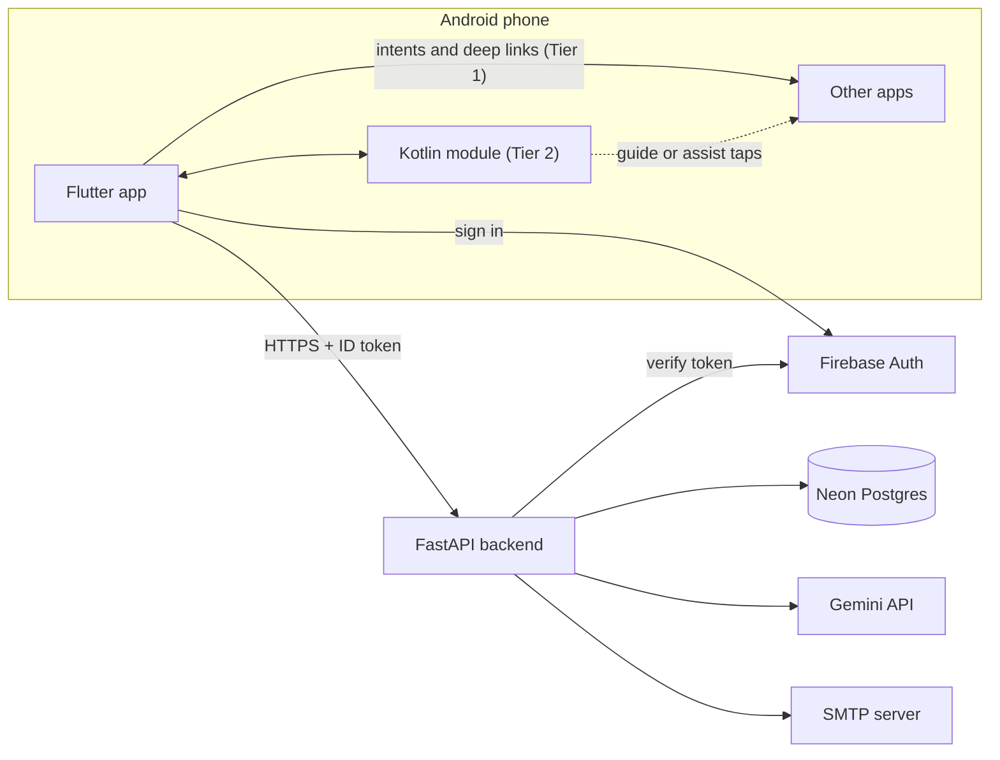
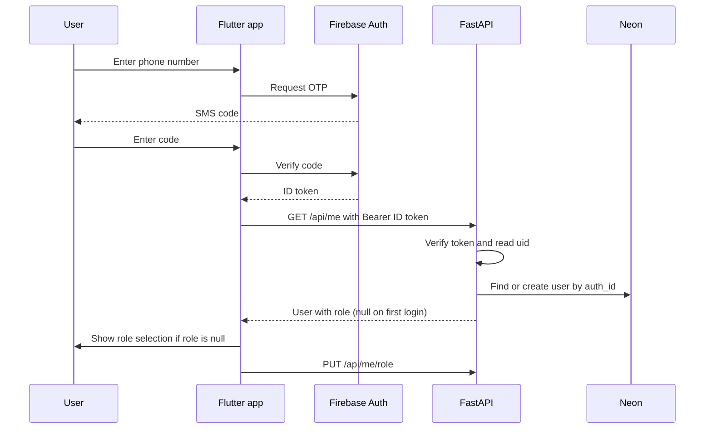
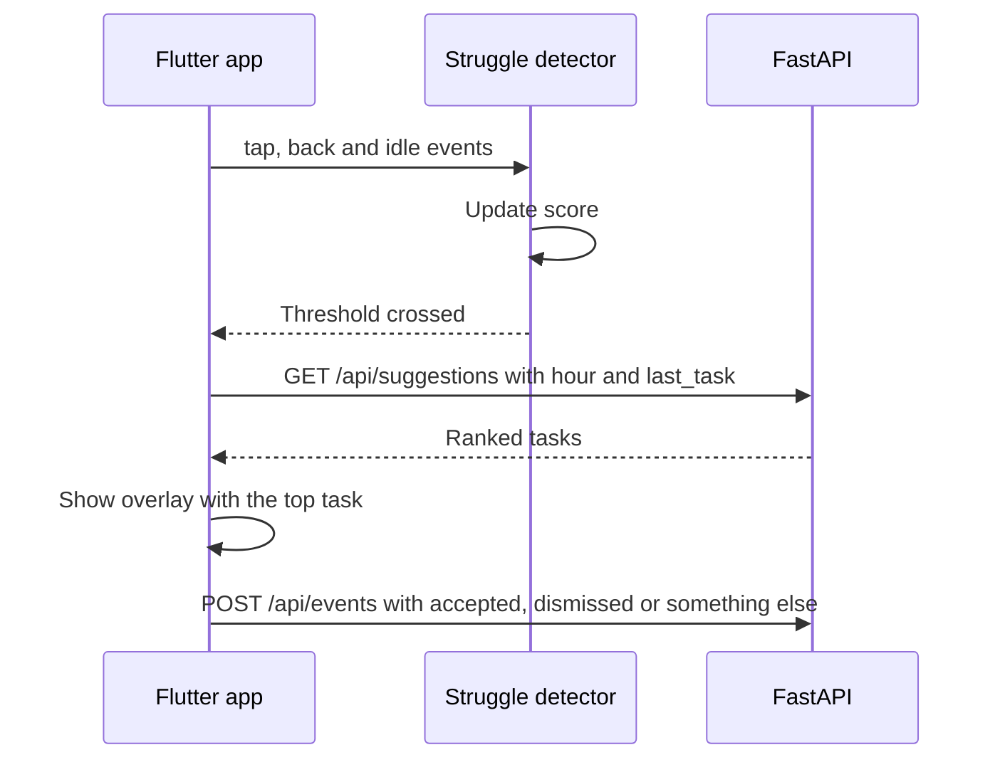
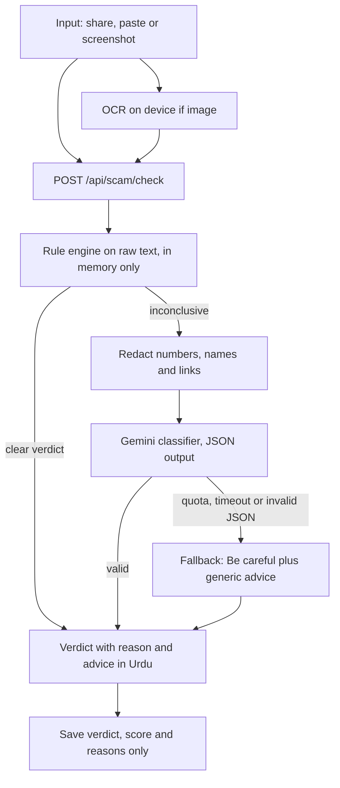
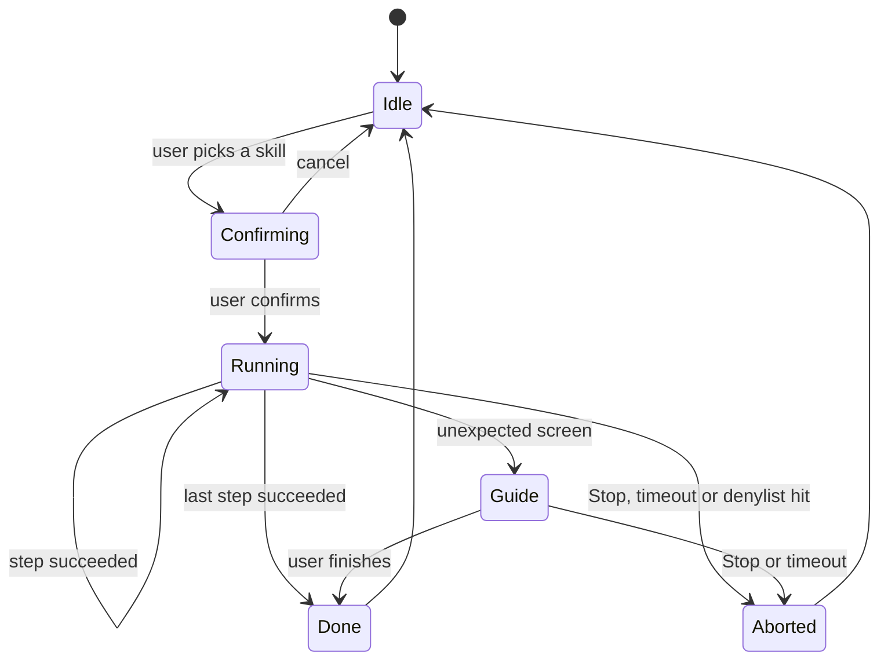
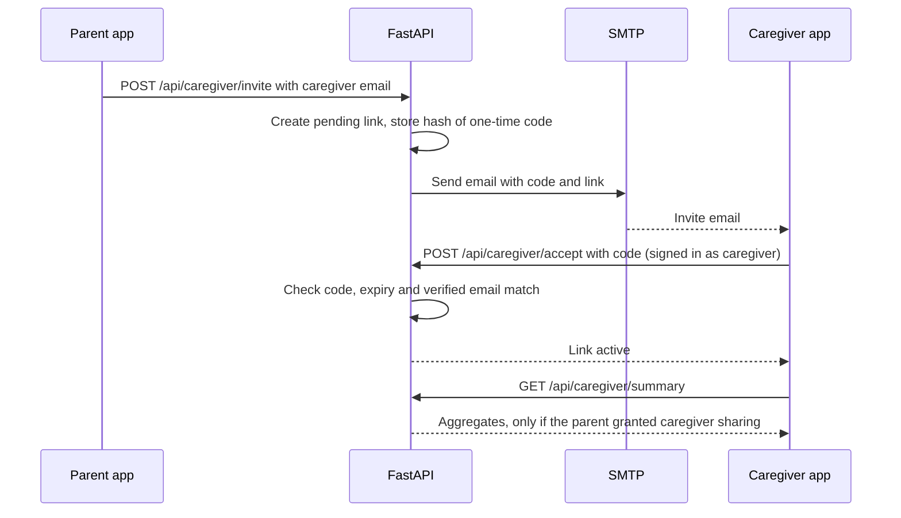
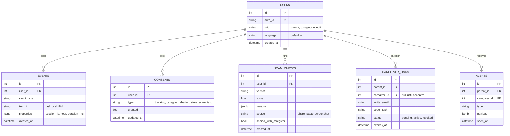

# Companion: Architecture

**Status:** Draft v0.1 (matches PRD v0.3)  
**Stack:** Android (Flutter + Kotlin module), FastAPI, Neon Postgres, Firebase Auth, Gemini, SMTP

---

## 1. Purpose and scope

This document describes how Companion is built: the components, how they talk to each other, the data they keep, and the order to build them in. It follows `prd.md`. Features are referred to by their PRD ids (F1 to F10).

Principles that drive the design:

1. **On-device first.** Struggle scoring, OCR and Tier 2 screen matching run on the phone. The backend only receives outcomes.
2. **Actions, not content.** No message text, contact names or other-app screen text is stored or logged.
3. **Rules before AI.** Every AI feature has a rule-based fallback, so the demo survives a quota limit or no network.
4. **Intents before accessibility.** Navigation uses standard Android intents (Tier 1) wherever possible. The Accessibility Service (Tier 2) is optional.
5. **Provider-neutral core.** Auth, LLM and email sit behind small interfaces, so swapping a provider touches one file.

---

## 2. System context



---

## 3. Components

### 3.1 Flutter app (UI and most logic)

| Module | Responsibility | PRD |
|---|---|---|
| `auth` | Firebase sign-in (phone OTP, email), role selection after first login, sign-out | F5 |
| `home` | Large task tiles, "Ask my family" button, bigger-text toggle | F1 |
| `core/event_logger` | Buffers events locally, flushes in batches, retries on failure | F2 |
| `core/struggle_detector` | Scores backtracking, idle time, repeated taps, looping, no completion | F2 |
| `overlay` | Dimmed screen, pulsing highlight, "Not now", read-aloud | F4 |
| `navigation/intent_navigator` | Opens dialer, WhatsApp chat, settings screens, maps, camera | F10 Tier 1 |
| `navigation/skill_bridge` | Talks to the Kotlin module over platform channels | F10 Tier 2 |
| `scam` | Share-target, paste, screenshot picker, on-device OCR, verdict screen | F6 |
| `voice` | Speech-to-text (Urdu), text-to-speech, intent mapping | F7 |
| `caregiver` | Invite by email, link management, summary and alerts screens | F9 |
| `core/api_client` | Adds the Firebase ID token to every request (fresh token per call) | all |
| `core/consent_store` | Local copy of consent choices, blocks logging until accepted | F5 |
| `l10n` | Urdu (right-to-left) and English strings | F7 |

### 3.2 Kotlin module (F10 Tier 2 only)

| Class | Responsibility |
|---|---|
| `CompanionAccessibilityService` | Receives window and view events, exposes the node tree to the skill runner, performs clicks |
| `SkillRunner` | Runs a skill (JSON) as a state machine with step budget, timeout and fallbacks |
| `OverlayController` | Draws the highlight, the "Companion is helping" indicator and the Stop button over other apps |
| `Denylist` | Package names and field types the service must ignore (banking, payments, password managers, password and OTP fields, security settings, installs) |
| `FlutterBridge` | MethodChannel (start skill, stop, status) and EventChannel (step progress, outcome) |

The service is declared in the manifest with `BIND_ACCESSIBILITY_SERVICE` and an accessibility config (event types, `flagReportViewIds`, retrieve window content, perform gestures). It is disabled until the user turns it on in Android settings.

### 3.3 FastAPI backend

| Layer | Responsibility |
|---|---|
| `routers/` | HTTP endpoints, request validation, role guards |
| `schemas/` | Pydantic request and response models |
| `services/` | Business logic: suggestions, scam rules, LLM gateway, redaction, invites |
| `core/` | Config, async DB session, Firebase token verification, dependencies, email sender |
| `models.py` | SQLAlchemy models |
| `migrations/` | Alembic migrations (schema is owned by Alembic, not `create_all`) |

### 3.4 External services

| Service | Used for | Notes |
|---|---|---|
| Firebase Auth | Phone OTP and email sign-in | Test phone numbers for the demo; add the app's SHA-1 and SHA-256 fingerprints |
| Neon Postgres | Storage | Use the pooled connection string for the app |
| Gemini API | Scam classification, intent parsing, simple-language rewrites | Free tier for the prototype, see section 9 for the data caveat |
| SMTP | Caregiver invite emails | Gmail with an app password, or a transactional email service |

---

## 4. Repository layout

### 4.1 Backend: current and target

Current (what exists now):

```
backend/
├─ main.py
├─ models.py                 User(clerk_id), Event
├─ init_db.py                to retire (Alembic owns the schema)
├─ alembic.ini
├─ migrations/
├─ core/
│  ├─ config.py
│  ├─ db.py
│  └─ auth.py                Clerk based, to be replaced
├─ routers/me.py             GET /api/me, POST /api/events (single event)
├─ schemas/events.py
├─ services/                 empty
└─ requirements.txt
```

Target:

```
backend/
├─ main.py
├─ models.py                 users, consents, events, caregiver_links, scam_checks, alerts
├─ core/
│  ├─ config.py              settings for Firebase, Gemini, SMTP
│  ├─ db.py
│  ├─ auth.py                Firebase ID token verification -> get_current_user
│  ├─ deps.py                require_role("parent") and require_role("caregiver")
│  └─ email.py               SMTP sender
├─ routers/
│  ├─ me.py                  profile, role, consent, delete data
│  ├─ events.py              batch event upload
│  ├─ suggestions.py
│  ├─ scam.py
│  ├─ voice.py
│  └─ caregiver.py
├─ schemas/                  one file per router
├─ services/
│  ├─ suggestions.py         counts by last task and time of day, defaults
│  ├─ scam_rules.py          pattern rules and scoring
│  ├─ redaction.py           strips numbers, names, links before any LLM call
│  ├─ llm_gateway.py         Gemini client, JSON validation, timeout, fallback
│  └─ invites.py             create, hash, email, accept, expire
└─ migrations/versions/
```

### 4.2 Flutter and Kotlin: current and target

Current:

```
lib/
├─ main.dart                 ClerkAuth wrapper (to be replaced)
├─ config.dart
└─ pages/
   ├─ home_page.dart         success page calling /api/me
   └─ login_page.dart        Clerk prebuilt UI (to be replaced)
```

Target:

```
lib/
├─ main.dart
├─ config.dart
├─ core/                     api_client, event_logger, struggle_detector, consent_store
├─ features/
│  ├─ auth/                  login_page, role_select_page
│  ├─ home/                  home_page, task_tile
│  ├─ overlay/               coach_overlay
│  ├─ navigation/            intent_navigator, skill_bridge
│  ├─ scam/                  scam_page, ocr_service
│  ├─ voice/                 voice_button, intent_mapper
│  └─ caregiver/             invite_page, summary_page, alerts_page
└─ l10n/                     app_ur.arb, app_en.arb

android/app/src/main/
├─ kotlin/.../               CompanionAccessibilityService, SkillRunner,
│                            OverlayController, Denylist, FlutterBridge
├─ res/xml/accessibility_service_config.xml
└─ assets/skills/            call_contact.json, open_whatsapp_chat.json, wifi_on.json
```

---

## 5. Key flows

### 5.1 Sign-in and role selection (F5)



Notes: ID tokens are short-lived, so the app fetches a fresh one per request. The role is stored on the backend and never trusted from the client after it is set. Token verification is synchronous, so the dependency is a normal `def` that FastAPI runs in a threadpool next to the async database code.

### 5.2 Struggle detection and suggestion (F2, F3, F4)



Ranking in `services/suggestions.py`: score = 2 x (times this task followed the last task) + (times the user did it in this part of the day), padded with defaults for new users. After 3 dismissals in a row the overlay backs off.

### 5.3 Scam check (F6, F8)



Rules run on the raw text in memory so they can see patterns such as OTP requests and mismatched link domains. Nothing is persisted, and redaction happens before any text leaves for Gemini.

### 5.4 Navigation (F10)

**Tier 1 (default):** a tile or a voice command maps to a task id. `intent_navigator` launches the matching intent: `ACTION_DIAL` with the saved number, a WhatsApp deep link, a settings action such as the Wi-Fi settings screen, or a maps URI. Android 11+ needs `<queries>` entries in the manifest so the app can resolve the target apps. A `nav_started` and `nav_completed` event is logged with the task id only.

**Tier 2 (optional):** a skill is a JSON file run by the Kotlin skill runner.

```json
{
  "id": "open_whatsapp_chat",
  "package": "com.whatsapp",
  "steps": [
    { "intent": "deep link to the saved contact" },
    { "wait_for": { "text_any": ["Type a message"] }, "timeout_s": 8 },
    { "highlight": { "id_any": ["illustrative.id/entry"] } }
  ],
  "limits": { "max_steps": 10, "timeout_s": 30 }
}
```

The selectors above are illustrative. Real ones must be found on the demo phone with the Layout Inspector or an accessibility inspector, and they will break when the target app updates.



The service ignores denylisted packages and password or OTP fields entirely. It never stores or sends text from other apps. Only `nav_*` outcome events (skill id and result) reach the backend.

### 5.5 Caregiver invite and summary (F9)



The parent starts the invite, which counts as their approval. Codes are single-use, stored hashed, and expire after 24 hours. Either side can revoke at any time, and revocation takes effect on the next request. Summaries contain counts and verdicts, never message text or contact names.

---

## 6. Data model



Notes:
- `users.clerk_id` becomes `auth_id` (holds the Firebase `uid`) via an Alembic migration, and `role` is added.
- Every table that references `users` uses `ON DELETE CASCADE`, so `DELETE /api/me/data` removes everything for that user.
- Task ids are a fixed set: `call`, `message`, `photos`, `bills`, `scam_check`, `help`, `wifi`.
- Existing index on `events (user_id, created_at)` stays. Add one on `events (user_id, event_type)` if suggestion queries get slow.

---

## 7. API contract (draft)

| Endpoint | Role | Purpose |
|---|---|---|
| `GET /api/me` | any | Profile, role, language, consent state |
| `PUT /api/me/role` | any, once | Set role to `parent` or `caregiver` if it is still null |
| `PUT /api/consent` | parent | Update a consent choice |
| `DELETE /api/me/data` | any | Delete all data and the account record |
| `POST /api/events` | parent | **Batch** upload (list of events, up to 100) |
| `GET /api/suggestions` | parent | Query: `hour`, `last_task`. Returns `{tasks: [...]}` |
| `POST /api/scam/check` | parent | Body: `text`, `source`. Returns verdict, reasons, advice |
| `POST /api/scam/{id}/share` | parent | Send the verdict (not the content) to linked caregivers |
| `POST /api/voice/intent` | parent | Body: `transcript`, `locale`. Returns `{task, confidence}` |
| `POST /api/caregiver/invite` | parent | Body: `email`. Sends the invite email |
| `POST /api/caregiver/accept` | caregiver | Body: `code`. Activates the link |
| `DELETE /api/caregiver/link/{id}` | parent or caregiver | Revoke |
| `GET /api/caregiver/summary` | caregiver | Aggregates for linked parents who consented |
| `GET /api/caregiver/alerts` | caregiver | Alert list |

Change from today: `POST /api/events` currently takes one event, and the app should send batches. Role guards come from `core/deps.py`. Error shape is `{"detail": "<machine_code>"}` with 401 for auth, 403 for role or consent, 422 for validation.

---

## 8. Configuration and secrets

**Backend `.env`** (never committed):

| Variable | Purpose |
|---|---|
| `DATABASE_URL` | `postgresql+psycopg://...` Neon pooled URL |
| `FIREBASE_PROJECT_ID` | Used to verify ID tokens (a service account is only needed for other Admin features) |
| `GEMINI_API_KEY` | Gemini calls, server side only |
| `GEMINI_MODEL` | Model name, so it can change without a code change |
| `SMTP_HOST`, `SMTP_PORT`, `SMTP_USER`, `SMTP_PASSWORD`, `SMTP_FROM` | Invite emails |
| `INVITE_BASE_URL` | Link placed in invite emails |
| `STRUGGLE_THRESHOLD` | Optional remote tuning value |

**Flutter:** `API_URL` (default is the PC's LAN IP for local testing), `google-services.json` from Firebase. No secret keys ship in the app.

---

## 9. Security and privacy architecture

| Concern | Design |
|---|---|
| Authentication | Firebase ID token on every request, verified server side, role read from the database |
| Authorization | `require_role` dependency, caregiver endpoints also check an active link and the parent's sharing consent |
| Transport | HTTPS outside local development (plain HTTP only on the LAN for testing) |
| Content minimization | Events hold action names and ids only. Scam text is processed in memory and not stored by default |
| LLM data | Redaction before every call, server-side only, JSON validated on return. **The Gemini free tier may use prompts and responses to improve Google products**, so during the prototype use synthetic or consenting-tester text, disclose it on the consent screen, and switch to the paid tier before real users |
| Accessibility Service | Off by default, explained before enabling, persistent indicator, denylist, always-visible Stop, no other-app text stored or sent |
| Secrets | Environment variables only, `.env` in `.gitignore` |
| Deletion | One endpoint cascades through every table |
| Logging | Request id, path and status only. Never log tokens, message text or email bodies |
| Rate limiting | Per-user limits on `/api/scam/check`, `/api/voice/intent` and `/api/caregiver/invite` |

---

## 10. Failure handling

| Failure | Behavior |
|---|---|
| Backend unreachable | App buffers events locally, home screen and Tier 1 navigation still work |
| Gemini quota, timeout or bad JSON | Scam check returns rule-based verdict or "Be careful" with generic advice. Voice falls back to the task list |
| Firebase or token error | App signs the user out and returns to the login screen |
| Suggestion endpoint fails | Show the default task list |
| SMTP failure | Invite stays pending, parent sees "email not sent, try again" |
| Tier 2 sees an unexpected screen | Skill runner falls back to Guide mode, then stops |
| Accessibility service disabled by Android or the user | Tier 2 features hide, Tier 1 keeps working |

---

## 11. Testing strategy

- **Backend:** pytest with `app.dependency_overrides` replacing `get_current_user` and the LLM gateway. Unit tests for `suggestions`, `scam_rules` (a labelled sample set gives recall and false-positive numbers for the PRD metrics) and `redaction`.
- **Struggle detector:** scripted event sequences that trigger each rule, plus a test that normal usage does not trigger.
- **Skill runner:** run each skill against the demo phone with the target app in a known state, three runs in a row. Add a denylist test and a Stop test.
- **End to end:** the demo script (section 13) walked through on a real phone.
- **Seed data:** a script that inserts a plausible event history for a demo user, clearly labelled as seeded in the write-up.

---

## 12. Deployment (hackathon)

- **Local:** `uvicorn main:app --host 0.0.0.0 --port 8000` on the PC, phone on the same Wi-Fi, Windows Firewall rule for port 8000.
- **If the venue network blocks device-to-device traffic:** use a tunnel (for example Cloudflare Tunnel or ngrok) or deploy to a free host, and set `API_URL` to the HTTPS address.
- **Tier 2 demo build:** sideloaded debug or release APK. On recent Android versions a sideloaded app's accessibility toggle may be blocked until the user allows restricted settings for it, so rehearse this on the demo phone.
- **Database:** Neon, one branch for demo and one for development.

---

## 13. Architecture decisions

| Decision | Choice | Reason |
|---|---|---|
| Client framework | Flutter plus a Kotlin module | One codebase for UI, native code only where Android requires it |
| Struggle detection | On the device | Privacy, less traffic, works offline |
| Prediction | Counting model (sequence and time-of-day counts) | Needs no training, explainable, enough for the demo |
| Navigation | Intents first, accessibility optional | Intents are publishable and low risk, accessibility is policy-sensitive |
| Skills | JSON files run by a state machine | No open-ended agent planning, easy to review and deny |
| Auth | Firebase, role stored server side | Phone OTP suits the audience, role cannot be forged client side |
| LLM access | Backend gateway only | Keeps keys off the device and allows redaction and fallbacks |
| Scam check | Rules first, Gemini second | Fast, cheap, works when the LLM does not |
| Invites | Emailed one-time code over SMTP | Simple, no push infrastructure needed |
| Schema | Alembic migrations | Tracked changes, safe renames such as `clerk_id` to `auth_id` |

---

## 14. Build order (about 5 hours)

| Hour | Work | Done when |
|---|---|---|
| 1 | Swap Clerk for Firebase: new `core/auth.py`, migration (`auth_id`, `role`), login page, role selection, `ApiClient` with Firebase token | Signing in shows the role screen and `/api/me` returns the user |
| 2 | Home tiles, batch event logging, struggle detector with debug panel | Each rule can be triggered on the phone |
| 3 | Overlay, `/api/suggestions`, Tier 1 intent navigation (call, WhatsApp, Wi-Fi settings) | Wandering triggers a suggestion and the tap opens the right screen |
| 4 | Consent screen, delete-my-data, feedback events, seeded demo data, scam check with rules | Nothing logs before consent, a scam sample gets an Urdu verdict |
| 5 | Gemini fallback for scam check, one Tier 2 skill or caregiver invite (pick one), demo rehearsal | The 3-minute demo runs end to end |

Anything that does not fit stays specified in the PRD and is shown as "next" in the pitch.

---

## 15. Migration checklist (current code to target)

1. Remove `clerk-backend-api` from `requirements.txt` and add `firebase-admin` (or `google-auth`).
2. Rewrite `core/auth.py` to verify Firebase ID tokens and return the user by `auth_id`.
3. Alembic migration: rename `clerk_id` to `auth_id`, add `role`, create `consents`, `caregiver_links`, `scam_checks`, `alerts`.
4. Delete `init_db.py` usage and rely on `alembic upgrade head`.
5. Change `POST /api/events` to accept a list.
6. Flutter: remove `clerk_flutter` and `clerk_auth`, add `firebase_core` and `firebase_auth`, replace `ClerkAuth` in `main.dart` with an auth gate (signed out, role selection, home).
7. Move pages into `features/` as the app grows, keeping `config.dart` for `API_URL`.
